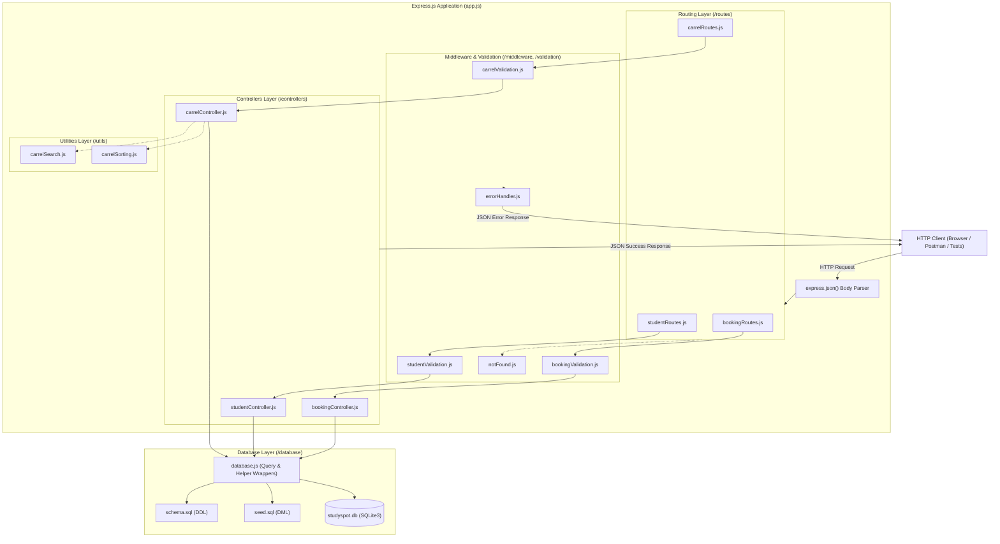
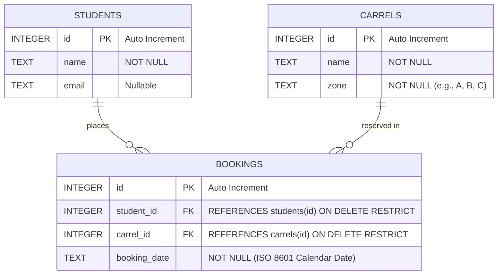

# StudySpot Cafe — Study Carrel Booking Management System

**Institution:** Aurora University  
**Course:** Backend Development Fundamentals  
**Group:** Group 4  
**Project:** StudySpot Cafe Backend REST API  
**Repository:** [studyspot-cafe-backend](https://github.com/bharathwajverse/studyspot-cafe-backend)  

---

## Table of Contents
1. [Project Title & Details](#1-project-title--details)
2. [University & Course Details](#2-university--course-details)
3. [Group Information](#3-group-information)
4. [Project Overview](#4-project-overview)
5. [Problem Statement](#5-problem-statement)
6. [Project Objectives](#6-project-objectives)
7. [Key Features](#7-key-features)
8. [Technology Stack](#8-technology-stack)
9. [System Architecture](#9-system-architecture)
10. [Project Directory Structure](#10-project-directory-structure)
11. [Database Design](#11-database-design)
12. [Entity-Relationship (ER) Diagram](#12-entity-relationship-er-diagram)
13. [Database Tables & Schema Relationships](#13-database-tables--schema-relationships)
14. [API Endpoint Documentation](#14-api-endpoint-documentation)
15. [Request and Response Examples](#15-request-and-response-examples)
16. [Input Validation Rules](#16-input-validation-rules)
17. [Search & Sorting Functionality](#17-search--sorting-functionality)
18. [Installation Instructions](#18-installation-instructions)
19. [Execution Instructions](#19-execution-instructions)
20. [Testing Instructions](#20-testing-instructions)
21. [Postman Collection Instructions](#21-postman-collection-instructions)
22. [Five-Member Responsibility Allocation](#22-five-member-responsibility-allocation)
23. [Learning Outcomes](#23-learning-outcomes)
24. [Conclusion](#24-conclusion)

---

## 1. Project Title & Details

**StudySpot Cafe – Study Carrel Booking Management System**  
A modular Node.js and Express RESTful API backend engineered for managing dedicated study carrel (study pod/cubicle) reservations within campus cafes and academic study centers as a student coursework project.

---

## 2. University & Course Details

- **University:** Aurora University
- **Department:** Computer Science & Information Technology
- **Course:** Backend Development Fundamentals
- **Term:** Fall / Academic Year 2026

---

## 3. Group Information

- **Group Designation:** Group 4
- **Project Role:** Backend Architecture, REST API Engineering, Relational Database Integration, and Automated Quality Assurance

---

## 4. Project Overview

Study cafes and university learning hubs provide students with quiet, distraction-free study pods known as *carrels*. Managing physical carrel allocations manually or via static spreadsheets leads to double-bookings, poor room utilization, lack of noise-zone clarity, and orphaned records.

**StudySpot Cafe** provides a structured academic backend service backed by an SQLite relational database with strict foreign-key enforcement (`PRAGMA foreign_keys = ON;`). The system delivers clean REST endpoints for student registration, full carrel inventory management, relational booking schedules using multi-table SQL `INNER JOIN` operations, zone-based search, allowlist-secured sorting, and comprehensive input validation.

---

## 5. Problem Statement

Campus study spaces face common operational bottlenecks:
- **Scheduling Conflicts & Inefficiencies:** Simultaneous manual reservations cause accidental double-allocations and seat conflicts.
- **Noise Zone Mismatches:** Students requiring silent focus often clash with group discussions due to lack of zone-based filtering (e.g., Silent Zone A, Semi-Quiet Zone B, Collaborative Zone C).
- **Data Integrity Vulnerabilities:** Without relational foreign-key enforcement, deleting a room or student record can corrupt existing booking histories.
- **Client-Side Overhead (N+1 Query Problem):** Naive APIs return IDs requiring clients to issue multiple repetitive requests to discover student and carrel names for each booking.

StudySpot Cafe resolves each issue with foreign-key constraints, parameterized queries, SQL JOIN data aggregation, and centralized middleware.

---

## 6. Project Objectives

1. **Modular Architecture:** Organize the codebase into clean, purpose-driven directories (`controllers/`, `routes/`, `middleware/`, `database/`, `validation/`, `utils/`, `tests/`, `postman/`).
2. **Relational Integrity:** Implement an SQLite schema binding `students`, `carrels`, and `bookings` with `ON DELETE RESTRICT` foreign keys.
3. **Safe Database Lifecycle:** Provide idempotent database initialization that creates schema tables and seeds initial data without duplicating rows upon server restarts.
4. **Full CRUD & Relational JOINs:** Deliver complete CRUD operations for carrels and single-query SQL `INNER JOIN` retrieval for bookings.
5. **Secure Search & Sorting:** Provide case-insensitive zone filtering and allowlist-governed sorting to eliminate SQL injection risks.
6. **Automated Testing & Documentation:** Verify all endpoints with a comprehensive automated test suite (65 tests passed, 0 failed) using the Node.js native test runner (`node:test`) and Supertest.

---

## 7. Key Features

- **Relational Integrity Enforcement:** Foreign keys enabled on every connection via SQLite `PRAGMA foreign_keys = ON;`.
- **Conflict-Resistant Deletions:** Deleting a carrel that has active bookings is blocked with `HTTP 409 Conflict`.
- **SQL JOIN Aggregation:** `GET /bookings` returns complete student names and carrel names alongside booking records in a single query.
- **Zone-Based Filtering:** Case-insensitive search query parameter (`?zone=A`) filters carrels dynamically.
- **Allowlist Sorting:** Deterministic sorting (`?sort=name&order=asc|desc`) with strict parameter validation.
- **Mandatory Error Requirement:** Querying unsupported fields such as `GET /carrels?sort=colour` strictly returns `HTTP 400 Bad Request` with the exact message: `"Cannot sort by that field"`.
- **Strict Input Validation:** Positive integer verification for all IDs, regex email validation, whitespace trimming, and real-calendar ISO 8601 date validation (accounting for leap years and month boundaries).
- **Comprehensive Test Suite:** 65 automated tests across 8 test suites passing with zero failures against an isolated temporary test database.

---

## 8. Technology Stack

| Layer | Technology | Purpose |
|---|---|---|
| **Runtime** | Node.js (Minimum: v18.0.0, Tested: v26.13.0) | JavaScript runtime environment |
| **Framework** | Express.js 4.21+ | Minimalist HTTP routing, request parsing, and middleware pipeline |
| **Database** | SQLite3 via `sqlite3` driver | Lightweight, file-based ACID-compliant relational database |
| **Integrity** | SQLite Foreign Key PRAGMA | Foreign key constraint enforcement (`ON DELETE RESTRICT`) |
| **Validation** | Custom Express Middleware | Sanitization, type validation, positive integer checks, calendar validation |
| **Testing** | Node.js Native Test Runner (`node:test`, `node:assert`) | Zero-dependency native assertion and test execution |
| **Integration Test** | Supertest 7.0+ | Programmatic HTTP assertion library for endpoint integration tests |
| **API Client & Docs** | Postman Collection v2.1 | Standardized test collection with pre-scripted assertions |

---

## 9. System Architecture

The application follows a modular, layered MVC-inspired backend architecture:



---

## 10. Project Directory Structure

```text
studyspot-cafe-backend/
├── controllers/
│   ├── studentController.js              # Student API operations (Member 1)
│   ├── carrelController.js               # Carrel CRUD operations (Member 3)
│   └── bookingController.js              # Booking operations & SQL JOIN (Member 5)
│
├── database/
│   ├── database.js                       # SQLite connection, query helpers, lifecycle (Member 2)
│   ├── schema.sql                        # Table definitions & foreign key constraints (Member 2)
│   ├── seed.sql                          # Initial seed data for students, carrels, bookings (Member 2)
│   └── data/
│       └── .gitkeep                      # Git tracking for runtime data directory
│
├── middleware/
│   ├── errorHandler.js                   # Centralized error handler & information shield (Member 1)
│   └── notFound.js                       # 404 handler for undefined endpoints (Member 1)
│
├── routes/
│   ├── studentRoutes.js                  # Routes for /students (Member 1)
│   ├── carrelRoutes.js                   # Routes for /carrels (Member 1)
│   └── bookingRoutes.js                  # Routes for /bookings (Member 1)
│
├── validation/
│   ├── carrelValidation.js               # Carrel body & positive integer ID validator (Member 4)
│   ├── studentValidation.js              # Student body validator (Member 4)
│   └── bookingValidation.js              # Booking body & calendar date validator (Member 4)
│
├── utils/
│   ├── carrelSearch.js                   # Zone filtering query builder (Member 4)
│   └── carrelSorting.js                  # Allowlist sorting validator & ORDER BY builder (Member 4)
│
├── postman/
│   └── StudySpot.postman_collection.json # Exportable Postman collection with test assertions (Member 5)
│
├── tests/
│   ├── api.test.js                       # 65-test comprehensive automated test suite (Member 5)
│   └── testSetup.js                      # Isolated temporary test database harness (Member 5)
│
├── screenshots/
│   └── .gitkeep                          # Dedicated screenshots directory
│
├── .gitignore                            # Excludes node_modules, *.db, *.sqlite, logs, coverage
├── README.md                             # Comprehensive project documentation
├── app.js                                # Express application setup & middleware assembly (Member 1)
├── server.js                             # HTTP server entrypoint & graceful shutdown (Member 1)
├── package.json                          # Project dependencies, scripts, and metadata
└── package-lock.json                     # Pinned dependency lockfile
```

---

## 11. Database Design

The database layer utilizes **SQLite3** configured with `PRAGMA foreign_keys = ON;` upon connection initialization.

Key architectural design decisions:
- **Relational Integrity:** Foreign keys use `ON DELETE RESTRICT` to prevent orphan records in the `bookings` table if a parent student or carrel is deleted.
- **Idempotent Initialization:** Server startup executes `initDatabase()`, which verifies table existence via `CREATE TABLE IF NOT EXISTS` and executes `seed.sql` only if tables are unseeded, preventing duplicate rows across restarts.
- **Parameterized Queries:** All SQL statements use positional placeholders (`?`) to prevent SQL injection vulnerabilities.

---

## 12. Entity-Relationship (ER) Diagram



---

## 13. Database Tables & Schema Relationships

### 13.1 `students` Table
Stores registered student identities.

| Column | Data Type | Constraints | Description |
|---|---|---|---|
| `id` | INTEGER | `PRIMARY KEY AUTOINCREMENT` | Unique identifier for each student |
| `name` | TEXT | `NOT NULL` | Full name of the student |
| `email` | TEXT | `NULLABLE` | Student university email address |

### 13.2 `carrels` Table
Stores study carrel rooms and cubicles categorized by study zone.

| Column | Data Type | Constraints | Description |
|---|---|---|---|
| `id` | INTEGER | `PRIMARY KEY AUTOINCREMENT` | Unique identifier for each carrel |
| `name` | TEXT | `NOT NULL` | Descriptive name (e.g., `"Carrel A-1"`) |
| `zone` | TEXT | `NOT NULL` | Designated activity zone (e.g., `"A"`, `"B"`, `"C"`) |

### 13.3 `bookings` Table
Associates students with carrels on specific calendar dates.

| Column | Data Type | Constraints | Description |
|---|---|---|---|
| `id` | INTEGER | `PRIMARY KEY AUTOINCREMENT` | Unique identifier for the booking |
| `student_id` | INTEGER | `NOT NULL`, `FOREIGN KEY` | References `students(id)` `ON DELETE RESTRICT` |
| `carrel_id` | INTEGER | `NOT NULL`, `FOREIGN KEY` | References `carrels(id)` `ON DELETE RESTRICT` |
| `booking_date` | TEXT | `NOT NULL` | Calendar date in valid ISO 8601 format |

---

## 14. API Endpoint Documentation

All endpoints return predictable, structured JSON responses adhering to:
- `success`: Boolean indicating operation outcome.
- `message`: Human-readable status description.
- `data`: Payload containing retrieved or created entities (on success).
- `errors`: Optional array of validation error strings (on failure).

### Complete Route Matrix

| Method | Endpoint | Query Parameters | Description | Status Code |
|---|---|---|---|---|
| `GET` | `/` | — | Base health check and API metadata | `200 OK` |
| `GET` | `/students` | — | Retrieve all registered students | `200 OK` |
| `GET` | `/students/:id` | — | Retrieve a student by ID | `200 OK` / `404 Not Found` |
| `POST` | `/students` | — | Register a new student | `201 Created` / `400 Bad Request` |
| `GET` | `/carrels` | `zone`, `sort`, `order` | Retrieve carrels with optional search & sort | `200 OK` / `400 Bad Request` |
| `GET` | `/carrels/:id` | — | Retrieve a carrel by ID | `200 OK` / `404 Not Found` |
| `POST` | `/carrels` | — | Create a new study carrel | `201 Created` / `400 Bad Request` |
| `PUT` | `/carrels/:id` | — | Update an existing study carrel | `200 OK` / `400 Bad Request` / `404 Not Found` |
| `DELETE`| `/carrels/:id` | — | Delete carrel (blocked if referenced) | `200 OK` / `404 Not Found` / `409 Conflict` |
| `GET` | `/bookings` | — | Retrieve all bookings with joined names | `200 OK` |
| `GET` | `/bookings/:id` | — | Retrieve a single booking with joined names | `200 OK` / `404 Not Found` |
| `POST` | `/bookings` | — | Create a new booking | `201 Created` / `400 Bad Request` / `404 Not Found` |

---

## 15. Request and Response Examples

### 15.1 Health Check Endpoint
**Request:**
```http
GET / HTTP/1.1
Host: localhost:3000
```
**Response (`200 OK`):**
```json
{
  "success": true,
  "message": "StudySpot Cafe API is operational",
  "group": "Group 4",
  "course": "Backend Development Fundamentals"
}
```

### 15.2 Create Carrel
**Request:**
```http
POST /carrels HTTP/1.1
Host: localhost:3000
Content-Type: application/json

{
  "name": "Focus Pod D-1",
  "zone": "D"
}
```
**Response (`201 Created`):**
```json
{
  "success": true,
  "message": "Carrel created successfully",
  "data": {
    "id": 11,
    "name": "Focus Pod D-1",
    "zone": "D"
  }
}
```

### 15.3 Retrieve Carrels by Zone Search
**Request:**
```http
GET /carrels?zone=B HTTP/1.1
Host: localhost:3000
```
**Response (`200 OK`):**
```json
{
  "success": true,
  "message": "Carrels retrieved successfully",
  "data": [
    {
      "id": 5,
      "name": "Carrel B-1",
      "zone": "B"
    },
    {
      "id": 6,
      "name": "Carrel B-2",
      "zone": "B"
    },
    {
      "id": 7,
      "name": "Carrel B-3",
      "zone": "B"
    }
  ]
}
```

### 15.4 Retrieve Carrels with Ascending Sorting
**Request:**
```http
GET /carrels?sort=name&order=asc HTTP/1.1
Host: localhost:3000
```
**Response (`200 OK`):**
```json
{
  "success": true,
  "message": "Carrels retrieved successfully",
  "data": [
    { "id": 1, "name": "Carrel A-1", "zone": "A" },
    { "id": 2, "name": "Carrel A-2", "zone": "A" },
    { "id": 3, "name": "Carrel A-3", "zone": "A" },
    { "id": 4, "name": "Carrel A-4", "zone": "A" },
    { "id": 5, "name": "Carrel B-1", "zone": "B" }
  ]
}
```

### 15.5 Invalid Sort Field (Group 4 Mandatory Requirement)
**Request:**
```http
GET /carrels?sort=colour HTTP/1.1
Host: localhost:3000
```
**Response (`400 Bad Request`):**
```json
{
  "success": false,
  "message": "Cannot sort by that field"
}
```

### 15.6 Retrieve Bookings via SQL JOIN
**Request:**
```http
GET /bookings HTTP/1.1
Host: localhost:3000
```
**SQL Executed Internally:**
```sql
SELECT 
    b.id AS id,
    b.booking_date AS booking_date,
    b.student_id AS student_id,
    s.name AS student_name,
    b.carrel_id AS carrel_id,
    c.name AS carrel_name
FROM bookings b
JOIN students s ON b.student_id = s.id
JOIN carrels c ON b.carrel_id = c.id
ORDER BY b.id ASC;
```
**Response (`200 OK`):**
```json
{
  "success": true,
  "message": "Bookings retrieved successfully",
  "data": [
    {
      "id": 1,
      "booking_date": "2026-11-20",
      "student_id": 1,
      "student_name": "Alice Johnson",
      "carrel_id": 1,
      "carrel_name": "Carrel A-1"
    },
    {
      "id": 2,
      "booking_date": "2026-11-21",
      "student_id": 2,
      "student_name": "Bob Smith",
      "carrel_id": 2,
      "carrel_name": "Carrel A-2"
    },
    {
      "id": 3,
      "booking_date": "2026-11-22",
      "student_id": 3,
      "student_name": "Clara Zhang",
      "carrel_id": 5,
      "carrel_name": "Carrel B-1"
    }
  ]
}
```

### 15.7 Delete Carrel with Existing Bookings (Conflict)
**Request:**
```http
DELETE /carrels/1 HTTP/1.1
Host: localhost:3000
```
**Response (`409 Conflict`):**
```json
{
  "success": false,
  "message": "Cannot delete carrel: existing bookings are associated with this carrel"
}
```

---

## 16. Input Validation Rules

Input validation is enforced through dedicated Express middleware modules in `validation/`:

### 16.1 ID Parameter Validation (`validateIdParam`)
- Applicable to all routes receiving `:id` (`/students/:id`, `/carrels/:id`, `/bookings/:id`).
- Must strictly be a positive integer (`1`, `2`, `10`).
- Rejects non-integers, alphanumeric strings (`12abc`), decimals (`1.5`), negatives (`-1`), zero (`0`), and empty strings with `HTTP 400 Bad Request`:
  ```json
  {
    "success": false,
    "message": "Invalid ID parameter. ID must be a positive integer"
  }
  ```

### 16.2 Student Validation (`validateStudent`)
- `name`: Required non-empty string. Whitespace is automatically trimmed. Rejects empty strings and whitespace-only strings.
- `email`: Optional. When supplied, must match valid RFC email regex (`/^[^\s@]+@[^\s@]+\.[^\s@]+$/`).

### 16.3 Carrel Validation (`validateCarrel`)
- `name`: Required non-empty string.
- `zone`: Required non-empty string.
- Automatically trims leading and trailing whitespace on valid submissions.

### 16.4 Booking Validation (`validateBooking`)
- `student_id`: Required positive integer.
- `carrel_id`: Required positive integer.
- `booking_date`: Required valid calendar date string in ISO 8601 format (`YYYY-MM-DD` or full ISO 8601 timestamp).
- **True Calendar Verification:** Explicitly accounts for month day limits and leap years. Rejects impossible dates such as `2026-02-30`, `2026-02-31`, `2026-13-01`, `2026-04-31`, and non-leap `2026-02-29` with `HTTP 400 Bad Request`.
- **Foreign Key Existence:** Verified against the database; returns `HTTP 404 Not Found` if the student or carrel does not exist.

---

## 17. Search & Sorting Functionality

### 17.1 Zone-Based Search (`utils/carrelSearch.js`)
- Endpoint: `GET /carrels?zone=A`
- Uses case-insensitive SQL matching: `WHERE UPPER(zone) = UPPER(?)`.
- Safely handles whitespace trimming and non-existent zones (returns `200 OK` with an empty array `[]`).

### 17.2 Allowlist Sorting (`utils/carrelSorting.js`)
- Endpoint: `GET /carrels?sort=name&order=asc|desc`
- Field allowlist: Only `'name'` is permitted.
- Order allowlist: Only `'asc'` and `'desc'` are permitted (defaults to `'asc'`).
- Adds primary key `id ASC` as a secondary sort criterion to ensure deterministic ordering.
- **Strict Error Handling:** Querying an unpermitted sort field (e.g., `?sort=colour`) immediately triggers:
  ```json
  {
    "success": false,
    "message": "Cannot sort by that field"
  }
  ```
- Combined filtering and sorting is supported: `GET /carrels?zone=A&sort=name&order=asc`.

---

## 18. Installation Instructions

### Prerequisites
- **Node.js:** Minimum supported: v18.0.0 (Tested: v26.13.0)
- **npm:** v9.0.0 or higher

### Step 1: Clone the Repository
```bash
git clone https://github.com/bharathwajverse/studyspot-cafe-backend.git
cd studyspot-cafe-backend
```

### Step 2: Install Dependencies
```bash
npm install
```

Installed packages:
- `express` (^4.21.2) — Web application framework
- `sqlite3` (^5.1.7) — SQLite database engine
- `supertest` (^7.0.0) — Automated API testing utility (devDependencies)

---

## 19. Execution Instructions

### Start the Server
```bash
npm start
```
Alternatively:
```bash
node server.js
```

### Expected Console Output
```text
Initializing SQLite database...
Database schema and seed data verified.
StudySpot Cafe server is running on port 3000
Base URL: http://localhost:3000
```

### Configurable Port
The application defaults to port `3000`. You can configure a custom port via the `PORT` environment variable:
```bash
# Linux / macOS
PORT=5000 npm start

# Windows PowerShell
$env:PORT="5000"; npm start
```

---

## 20. Testing Instructions

The automated test suite runs on Node.js's built-in test runner (`node:test`) and Supertest.

### Isolated Test Database Guarantee
Tests execute against a temporary test database (`tests/test_studyspot.db`) initialized via `tests/testSetup.js`. The test suite never modifies or deletes data in the development database (`database/data/studyspot.db`).

### Run the Complete Test Suite
```bash
npm test
```
Or directly:
```bash
node --test tests/api.test.js
```

### Test Suite Execution Summary
```text
▶ StudySpot Cafe - Group 4 API Automated Test Suite
  ▶ General Routing & Health Check (2 tests)
  ▶ Students API (10 tests)
  ▶ Carrel CRUD & Input Validation (19 tests)
  ▶ Zone-Based Search (4 tests)
  ▶ Ascending and Descending Sorting (5 tests)
  ▶ Bookings JOIN API (23 tests)
  ▶ Database Initialization & Restart Idempotency (2 tests)
✔ StudySpot Cafe - Group 4 API Automated Test Suite
ℹ tests 65
ℹ suites 8
ℹ pass 65
ℹ fail 0
ℹ cancelled 0
ℹ skipped 0
ℹ todo 0
```

---

## 21. Postman Collection Instructions

An official Postman collection is maintained at:
`postman/StudySpot.postman_collection.json`

### Import & Execution Steps
1. Launch **Postman** (Desktop application or Web).
2. Click **Import** in the top-left navigation panel.
3. Choose or drag-and-drop `postman/StudySpot.postman_collection.json`.
4. Select the imported collection: **StudySpot Cafe - Study Carrel Booking Management System**.
5. Verify the collection variable `baseUrl` is set to `http://localhost:3000`.
6. Start the local server (`npm start`).
7. Run individual requests or use the **Collection Runner** to execute all folders sequentially:
   - `1. Students`
   - `2. Carrels`
   - `3. Bookings`
   - `4. Search and Sorting`
   - `5. Validation and Error Handling`

All requests contain automated JavaScript assertions testing status codes, response structures, and exact error messages.

---

## 22. Five-Member Responsibility Allocation

To reflect both individual team member ownership and harmonious integration, project responsibilities are mapped as follows:

| Team Member | Functional Area | Specific Modules & Responsibilities | Core Files Owned |
|---|---|---|---|
| **Member 1** | **Backend Setup, Routing & Student API** | Express application bootstrapping, JSON body parsing, route mounting, student controller endpoints (`GET all`, `GET by ID`, `POST`), centralized error middleware, and 404 handler. | `app.js`<br>`server.js`<br>`routes/`<br>`middleware/`<br>`controllers/studentController.js` |
| **Member 2** | **Database Management** | SQLite3 singleton connection management, foreign key PRAGMA configuration, DDL schema creation, DML seed data population, idempotent restart logic, and query helper promises. | `database/database.js`<br>`database/schema.sql`<br>`database/seed.sql`<br>`database/data/` |
| **Member 3** | **Carrel CRUD Operations** | Implementation of Create, Read (all/single), Update, and Delete endpoints for study carrels, database query execution, conflict handling on deletion, and HTTP response formatting. | `controllers/carrelController.js` |
| **Member 4** | **Validation, Search & Sorting** | Middleware validation for carrels, students, and bookings; positive integer ID checks; calendar date & leap year verification; zone search filter builder; allowlisted sorting and error handling. | `validation/carrelValidation.js`<br>`validation/studentValidation.js`<br>`validation/bookingValidation.js`<br>`utils/carrelSearch.js`<br>`utils/carrelSorting.js` |
| **Member 5** | **Bookings JOIN, Testing & Documentation** | SQL `INNER JOIN` bookings implementation, foreign key reference verification, Supertest automated test suite (65 tests), isolated test database setup, and Postman v2.1 collection. | `controllers/bookingController.js`<br>`tests/api.test.js`<br>`tests/testSetup.js`<br>`postman/StudySpot.postman_collection.json` |

---

## 23. Learning Outcomes

Through completing this group project, the team mastered key backend engineering principles:
1. **Separation of Concerns:** Transitioned from member-based folder silos into a professional, purpose-based modular architecture (`controllers`, `routes`, `middleware`, `database`, `utils`, `validation`).
2. **Relational Integrity in SQLite:** Configured foreign key pragma constraints and handled relational deletion conflicts gracefully (`HTTP 409 Conflict`).
3. **Multi-Table SQL JOINs:** Designed performant relational `INNER JOIN` queries that resolve related entities in a single roundtrip, eliminating client N+1 queries.
4. **Defensive Validation & Security:** Implemented allowlist query parameter validation and parameterized queries to prevent SQL injection and malicious input.
5. **Robust Quality Assurance:** Authored an isolated automated integration test suite with 65 tests verifying edge cases, malformed IDs, impossible calendar dates, and database restart idempotency.

---

## 24. Conclusion

The **StudySpot Cafe** backend delivers a secure, extensible, and fully verified RESTful API for academic study carrel management. By refactoring the project into a clean, purpose-based modular structure, the repository demonstrates sound software engineering principles while strictly preserving every team member's functional contribution and passing all 65 automated tests.
